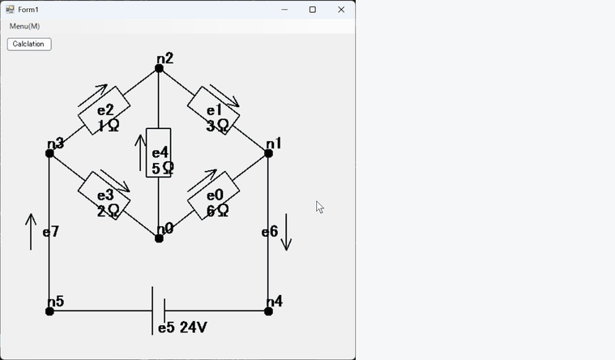

# Graph — グラフ理論による電気回路ソルバー

> **高専4年生のときに個人で制作したプロジェクトです。**（制作時期：2024年1月〜2月）

電気回路を「グラフ（ノードとエッジ）」として表現し、グラフ理論のアルゴリズムで**閉路（ループ）を自動抽出**して、**閉路電流法（ループ解析）**で各枝の電流を求める Windows デスクトップアプリケーションです。
回路の描画、木・補木の探索、回路方程式の組み立て、LU分解による連立方程式の求解までを、外部ライブラリを使わずに C# で一から実装しました。



*ホイートストンブリッジ回路のノード（n0）をドラッグで動かし（つながった素子や電流の矢印も追従します）、「Calclation」ボタンで各枝の電流を計算している様子*

---

## 主な機能

- **回路のグラフ表示**
  エッジを素子の種類に応じた回路記号（抵抗・直流電圧源・導線）で描画します。各枝には電流の向きを示す矢印を表示します。
- **ドラッグ&ドロップによるノード移動**
  マウスでノードをつかんで動かすと、接続された素子・矢印も追従して再描画されます。
- **閉路の自動検出**
  深さ優先探索（DFS）で全域木を求め、補木（リンク）の各エッジから基本閉路を抽出します。
- **回路方程式の自動生成と求解**
  タイセット行列 **B** とインピーダンス行列 **Z** を組み立て、LU分解で閉路電流を計算します。
- **計算結果の表示**
  「Calclation」ボタンを押すと、各枝の電流 `I0, I1, …[A]` を別ウィンドウに表示します。

## 解析の流れ

```
回路（ノード・エッジ・素子値）
        │
        ▼
① DFS で全域木（tree）と補木（cotree）に分類        … Graph.DFS()
        │
        ▼
② 補木の各エッジ＋木の経路 → 基本閉路を抽出         … Graph.LoopDetecter()
        │
        ▼
③ タイセット行列 B，インピーダンス行列 Z，
   閉路の電源電圧ベクトル Vs を作成                   … CircuitEquation.setB() / setZ()
        │
        ▼
④ (B Z Bᵀ) Iₗ = Vs を LU分解で解く（前進・後退代入） … CircuitEquation.LUsolve()
        │
        ▼
⑤ 枝電流  I = Bᵀ Iₗ  を算出して表示                  … Form2
```

基本閉路の数は「エッジ数 − ノード数 + 1」になり、閉路電流法では節点電位法などと比べて未知数をこの数に抑えられます。
これを「木と補木」というグラフ理論の考え方に沿って自動で求めているのが、このプロジェクトの中心です。

## 工夫した点

- **回路解析をグラフの問題として捉え直した**
  授業で習った閉路電流法を、手計算ではなく「どの回路にも使える手順」にするため、全域木→基本閉路→タイセット行列という流れでプログラムに落とし込みました。
- **閉路探索アルゴリズムの試行錯誤**
  閉路検出は何度も実装を作り直しています（`Graph.cs` の `LDHelper` 系メソッド）。最終的には木のエッジだけをたどる DFS に `seen` / `finished` フラグを持たせ、行き止まりでバックトラックする方式（`LDHelper2`）に落ち着きました。
- **行列演算の自作**
  行列の積・転置・LU分解（Doolittle法）を `Matrix` クラスとして実装し、数値計算の中身を理解しながら作りました。
- **回路記号の描画を幾何計算で実装**
  エッジの向きベクトルを正規化し、その法線方向にオフセットを取ることで、どの角度の枝でも抵抗（ジグザグ）・電源・矢印が正しく描かれるようにしました。

## 動作環境

| 項目 | 内容 |
|---|---|
| 言語 | C# |
| フレームワーク | .NET Framework 4.8 / Windows Forms |
| 開発環境 | Visual Studio |
| 対応OS | Windows |

## ビルド・実行方法

1. Visual Studio で `Graph/Graph.sln` を開く
2. `F5`（デバッグ実行）または `Ctrl + F5` で起動
3. サンプル回路（ホイートストンブリッジ）が表示される。ノードはドラッグで自由に動かせる
4. 左上の **Calclation** ボタンで各枝の電流を計算・表示

> 計算過程（電圧ベクトルや閉路電流 Iₗ など）は Visual Studio の出力ウィンドウ（コンソール）にも表示されます。

### サンプル回路

起動時には `Form1.cs` で定義した次の回路が読み込まれます（6ノード・8エッジ）。
ノードは一般的なホイートストンブリッジの形（ひし形のブリッジと、下側に電源）に配置しています。

```
             n2
          ╱  │  ╲
       e2    │    e1
      ╱      e4     ╲
    n3       │       n1
    │ ╲      │      ╱ │
    │   e3   │   e0   │
   e7     ╲  │  ╱    e6
    │        n0       │
    │                 │
    n5 ──── e5 ────── n4
          (24 V)
```

| エッジ | 接続 | 素子 | 値 |
|---|---|---|---|
| e0 | n0 – n1 | 抵抗 | 6 Ω |
| e1 | n2 – n1 | 抵抗 | 3 Ω |
| e2 | n3 – n2 | 抵抗 | 1 Ω |
| e3 | n3 – n0 | 抵抗 | 2 Ω |
| e4 | n0 – n2 | 抵抗 | 5 Ω |
| e5 | n4 – n5 | 直流電圧源 | 24 V |
| e6 | n1 – n4 | 導線 | — |
| e7 | n5 – n3 | 導線 | — |

抵抗がブリッジ状に組まれた、手計算だと少し面倒な回路を題材にしています。

**計算結果と検算**

| 枝 | I0 (e0) | I1 (e1) | I2 (e2) | I3 (e3) | I4 (e4) | I5〜I7 (電源・導線) |
|---|---|---|---|---|---|---|
| 電流 [A] | 3 | 6 | 6 | 3 | 0 | 9 |

6Ω : 2Ω = 3Ω : 1Ω でブリッジが平衡しているため、中央の e4（5Ω）には電流が流れません（I4 = 0）。
このとき合成抵抗は (6+2) Ω と (3+1) Ω の並列で 8/3 Ω になり、全電流は 24 V ÷ 8/3 Ω = 9 A です。
各経路には 3 A と 6 A が流れ、プログラムの出力は手計算と一致します。

## ディレクトリ構成

```
Graph/
├── README.md
├── graph.cs                 # 制作初期の試し書き（ビルド対象外）
├── docs/
│   └── demo.gif             # 実行の様子
└── Graph/
    ├── Graph.sln / Graph.csproj
    ├── Program.cs           # エントリポイント
    ├── Form1.cs             # メイン画面：描画・マウス操作・サンプル回路定義
    ├── Form2.cs             # 計算結果（枝電流）表示ウィンドウ
    ├── Graph.cs             # グラフ本体：描画、DFS、閉路検出
    ├── Node.cs              # ノード（座標・接続エッジ）
    ├── Edge.cs              # エッジ（始点・終点・素子種別・素子値）
    ├── CircuitEquation.cs   # 回路方程式の組み立てと求解
    ├── Matrix.cs            # 行列演算（積・転置・LU分解）
    └── Circuit.cs           # Graph のラッパー（未使用）
```

### 素子の種類（`Edge.element`）

| 値 | 素子 | 対応状況 |
|---|---|---|
| 0 | 導線（短絡） | ✅ |
| 1 | 直流電圧源 | ✅ |
| 2 | 抵抗 | ✅ |
| 3 | コンデンサ | 未実装 |
| 4 | コイル | 未実装 |

## 現状の制約と今後の課題

学習目的で作ったプロトタイプのため、次のような未完成の部分があります。

- 回路はコード（`Form1.cs`）で定義しており、GUI からのノード／エッジ追加は途中まで（メニューのみ）
- 扱えるのは直流の抵抗回路のみ。コンデンサ・コイルを複素インピーダンスで扱えば交流回路にも拡張できる
- LU分解でピボット選択をしていないため、行列の形によっては数値的に不安定になる
- 閉路検出の試作コードやデバッグ出力が残っており、整理の余地がある

## 作者

Ryodai Toda（高専4年次に制作）
